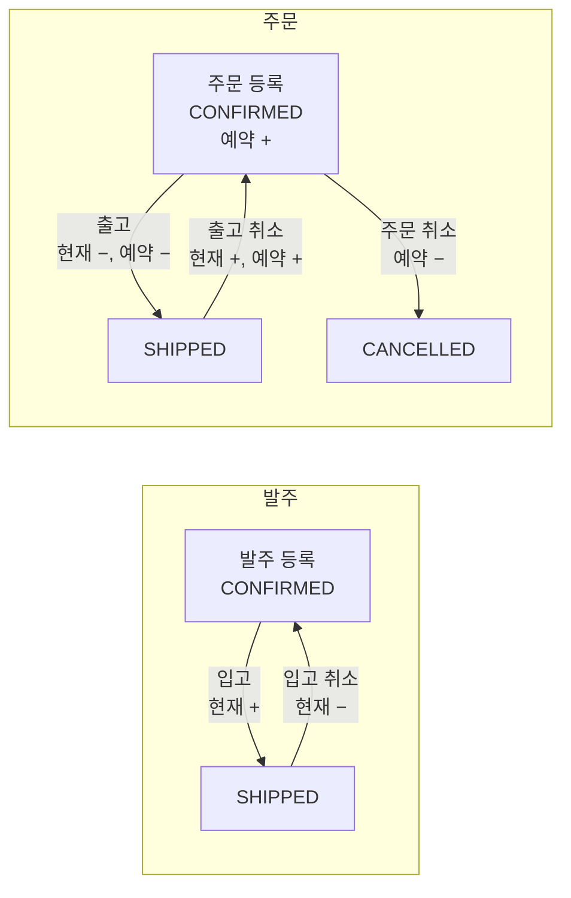

# 📦 MyERP — 멀티테넌트 ERP

여러 회사가 함께 쓰는 ERP 백엔드입니다. 품목 등록부터 발주 → 입고, 주문 → 출고까지 한 흐름으로 처리하고, 현재 재고와 예약 재고를 자동으로 반영합니다.
**다른 회사 데이터는 볼 수 없고, 동시에 처리해도 재고가 틀리지 않는 것**을 가장 중요하게 설계했습니다.

| 📅 기간                   | 👤 인원    | 📄 API 문서             |
|-------------------------|----------|-----------------------|
| 2025.08.01 ~ 2025.09.18 | 1인 (백엔드) | 서버 실행 후 `/swagger-ui` |

<br>

## 📌 핵심 요약

| 주제                                  | 결과                                                           |
|-------------------------------------|--------------------------------------------------------------|
| [🏢 멀티테넌트 격리](#-1-멀티테넌트-데이터-격리)     | 토큰의 회사 ID를 **요청마다 DB와 대조**, 모든 쿼리의 **JOIN 테이블마다** 회사 조건      |
| [📦 재고 동시성](#-2-재고-동시성--조건부-update) | **조건부 UPDATE + 변경 건수 검증**으로 락 없이 재고 음수·같은 주문 중복 출고 차단        |
| [🔢 코드 중복 방지](#-3-코드-중복-방지)         | 미리 조회하지 않고 **DB 유니크 제약 + 최대 5회 재시도**                         |
| [📝 감사 로그](#-4-감사-로그)               | `REQUIRES_NEW` + AOP로 **실패한 작업까지 기록**, 요청 추적 ID로 한 요청의 흐름 추적 |

<br>

## ✨ 주요 기능

| 영역    | 기능                                                                              |
|-------|---------------------------------------------------------------------------------|
| 회사    | 회사 등록·수정·검색, 소프트 삭제 (하위 데이터가 있으면 삭제 불가)                                         |
| 조직    | 사원 등록·수정·퇴사(ERP 계정 비활성화 연동), 부서 계층 구조, 직급 순서 변경                                 |
| 품목·재고 | 품목 등록 시 재고 자동 생성, 현재·예약·가용 재고 조회, 품목별 입출고 변동 내역, 소프트 삭제 (재고·진행 중 발주·주문이 있으면 불가) |
| 발주·입고 | 발주 등록·취소, 입고 처리 시 재고 증가, 입고 취소 시 롤백                                             |
| 주문·출고 | 주문 등록 시 예약 재고 확보, 출고 처리 시 재고 차감, 출고 취소 시 롤백                                     |
| 리포트   | CTE·`UNION ALL`로 월별 매출·매입, 품목별 입출고·재고 현황, 전년 동월 비교                              |
| 로그    | 접속·로그인·업무 감사 로그, 요청 추적 ID, 보관 기간별 자동 삭제                                         |

| 역할      | 접근 경로                                 | 권한                        |
|---------|---------------------------------------|---------------------------|
| `SYS`   | `/api/v1/sys/**`                      | 회사 관리                     |
| `ADMIN` | `/api/v1/admin/**`, `/api/v1/user/**` | 사원·부서·직급 관리 + 일반 업무       |
| `USER`  | `/api/v1/user/**`                     | 품목, 발주·입고, 주문·출고, 재고, 리포트 |

<br>

## 🛠 기술 스택

| 구분           | 기술                                                                        |
|--------------|---------------------------------------------------------------------------|
| Backend      | Java, Spring Boot, Spring Security, Spring AOP, MyBatis <!-- TODO: 버전 --> |
| 인증           | JWT (Access 1시간 / Refresh 14일)                                            |
| DB           | Oracle <!-- TODO: 버전 -->                                                  |
| Docs / Build | springdoc-openapi (Swagger), Maven                                        |

<br>

## 🏗 아키텍처

```mermaid
flowchart LR
    U[클라이언트] --> A

    subgraph F[보안 필터]
        A[RequestIdFilter<br/>추적 ID 부여] --> B[JwtAuthenticationFilter<br/>토큰 검증]
        B --> C[TenantScopeGuardFilter<br/>회사 ID를 DB와 대조]
        C --> D[AccessLogFilter<br/>접속 로그]
        D --> E[CompanyActiveGuardFilter<br/>비활성 회사 차단]
    end

    E --> S[Controller → Service → MyBatis]
    S --> O[(Oracle)]
    S -.->|@Auditable · REQUIRES_NEW| L[(감사 로그)]
```

- 회사 ID는 ThreadLocal(`TenantContext`)에 담아 요청 처리 내내 사용하고, 요청이 끝나면 `finally`에서 항상 비웁니다.

<br>

## 🗃 ERD


- `COMPANY`를 제외한 모든 업무 테이블에 `company_id`가 있습니다 (그림에서 생략) → [1. 멀티테넌트 데이터 격리](#-1-멀티테넌트-데이터-격리)
- 모든 테이블에 `created_at`, `updated_at` (DB 트리거로 자동 기록, 생략)

<br>

## 🏢 1. 멀티테넌트 데이터 격리

### 문제

여러 회사가 같은 서버와 DB를 씁니다. 회사 ID를 토큰 값만 믿고 쓰면, 토큰이 잘못 발급되거나 계정 소속이 바뀐 경우 **다른 회사 데이터를 조회**할 수 있습니다. 또 쿼리
하나라도 회사 조건을 빠뜨리면 그대로 데이터가 섞입니다.

### 해결 — 두 단계로 막기

| 단계  | 방법                                                                                            |
|-----|-----------------------------------------------------------------------------------------------|
| 요청  | 토큰의 회사 ID는 참고만 하고, 요청마다 **DB에서 계정의 실제 회사 ID를 조회해 대조**. 다르면 `TENANT_MISMATCH`로 403             |
| SQL | 회사 조건을 공통 SQL 조각으로 만들어 모든 쿼리에 포함. JOIN하는 **테이블마다** 별칭별로 걸어, 조인 상대 테이블에서 다른 회사 데이터가 섞이는 것까지 차단 |

```xml
<!-- TenantFragments.xml -->
<sql id="tenantGuardAlias">${alias}.company_id = #{tenantId}</sql>

  <!-- 사용 예: 주문 목록 -->
  AND <include refid="frag.tenantGuardAlias">
<property name="alias" value="o"/>
</include>
  AND <include refid="frag.tenantGuardAlias">
<property name="alias" value="oi"/>
</include>
  AND <include refid="frag.tenantGuardAlias">
<property name="alias" value="e"/>
</include>
```

→ [`TenantScopeGuardFilter`](src/main/java/erp/auth/security/filter/TenantScopeGuardFilter.java)

**알고 있는 한계:** 요청마다 DB를 한 번 더 조회해서, JWT의 장점인 "DB 없이 인증"을 일부 포기한 구조입니다. 데이터 격리를 성능보다 우선한 선택이며, 사용자가 늘면
캐시를 고려하겠습니다.

<br>

## 📦 2. 재고 동시성 — 조건부 UPDATE

### 문제

재고는 **현재 재고(on_hand)** 와 **예약 재고(allocated)** 로 관리하고, 주문 가능한 수량은 **가용 재고 = 현재 − 예약**입니다.



"재고 확인 → 차감"을 두 번에 나눠 하면, 두 요청이 동시에 확인했을 때 **둘 다 충분하다고 보고 재고가 음수**가 될 수 있습니다. 같은 주문을 두 사람이 동시에 출고하는
경우도 마찬가지입니다.

### 해결

확인과 변경을 **쿼리 하나**로 처리하고, 바뀐 행이 정확히 1건인지 검증합니다. 0건이면 예외를 던져 **트랜잭션 전체를 롤백**합니다.

```sql
-- 주문: 가용 재고가 충분할 때만 예약
UPDATE stock
SET allocated_quantity = allocated_quantity + #{quantity}
WHERE item_id = #{itemId}
  AND on_hand_quantity - allocated_quantity >= #{quantity}

-- 출고: 주문이 CONFIRMED일 때만 SHIPPED로
UPDATE orders
SET status = 'SHIPPED'
WHERE order_id = #{orderId}
  AND status = 'CONFIRMED'
```

상태 변경이 실패하면 원인(이미 출고됨, 취소됨 등)을 다시 조회해 구체적인 에러로 응답합니다.

### 왜 비관적 락이 아닌가

재고는 **이미 있는 한 행의 숫자를 바꾸는** 작업이라, 조건을 UPDATE 안에 넣으면 DB가 확인과 변경을 원자적으로 처리합니다. 별도의 잠금 조회가 필요 없습니다.
반면 [MedLink](https://github.com/imeline/medLink)의 예약은 "그 시간이 비었는지 확인하고 **새 행을 INSERT**"하는 작업이라 조건을 걸
기존 행이 없어서 비관적 락을 썼습니다.

### 바로잡은 것

처음에는 주문 시 `on_hand >= 수량`만 확인해서, 이미 다른 주문에 예약된 재고까지 다시 예약할 수 있었습니다 (현재 10, 예약 8인 상태에서 5개 주문 통과 → 예약
13). 출고 시점 검사로 재고가 음수가 되지는 않았지만 **확정된 주문이 나중에 출고되지 못하는** 문제가 남아, 조건을 **가용 재고 기준**으로 고쳤습니다.

→ [`StockServiceImpl`](src/main/java/erp/stock/service/StockServiceImpl.java) · [
`OutboundServiceImpl`](src/main/java/erp/outbound/service/OutboundServiceImpl.java)

**알고 있는 한계:** 동시 요청 테스트로 검증하지는 못했습니다. 또 출고는 재고를 먼저 줄이고 상태 변경을 마지막에 해서, 이미 출고된 주문이면 재고 작업 후에 실패(롤백)
합니다. 상태 변경을 맨 앞으로 옮기면 더 빨리 실패하고, 같은 주문의 동시 출고도 그 지점에서 바로 줄 세울 수 있습니다.

<br>

## 🔢 3. 코드 중복 방지

### 문제

발주·주문·입고·출고 코드(`PO-2025-XXXXXXXX`)를 랜덤으로 만드는데, "중복인지 먼저 조회 → 저장"으로 하면 그 사이에 같은 코드가 저장될 수 있습니다.

### 해결

- 미리 조회하지 않고 바로 저장해 **DB 유니크 제약**이 중복을 막게 함
- `DuplicateKeyException`이 나면 새 코드로 최대 5회 재시도
- 코드는 `SecureRandom` 8자리, 헷갈리는 문자(I, O, 0, 1) 제외

→ [`Codes`](src/main/java/erp/global/util/Codes.java) · [
`OrderServiceImpl`](src/main/java/erp/order/service/OrderServiceImpl.java)

<br>

## 📝 4. 감사 로그

### 문제

ERP는 "누가 언제 무엇을 했는지"가 남아야 합니다. 그런데 로그를 업무와 **같은 트랜잭션**에 저장하면, 작업이 실패해 롤백될 때 **실패 기록까지 함께 사라집니다.**

### 해결

| 고민                    | 해결                                            |
|-----------------------|-----------------------------------------------|
| 롤백 시 로그도 사라짐          | 로그 저장을 `REQUIRES_NEW`로 **별도 트랜잭션** 분리         |
| 업무 코드에 로그 코드가 섞임      | AOP `@Auditable` 한 줄 + SpEL로 메시지 생성           |
| 로그 저장 실패가 사용자 요청을 깨뜨림 | 로그 저장 예외는 경고만 남기고 응답에 영향 없게                   |
| 비밀번호·토큰이 로그에 남음       | 민감 키 자동 마스킹, 페이로드 32KB 제한                     |
| 한 요청의 흐름을 찾기 어려움      | `X-Request-Id`를 응답 헤더·서버 로그(MDC)·DB 로그에 함께 기록 |
| 로그가 끝없이 쌓임            | 종류별 보관 기간에 맞춰 매일 새벽 3시 자동 삭제                  |

```java

@Auditable(type = LogType.WORK, messageEl = "'발주 취소: purchaseId=' + #args[0]")
public void cancelPurchase(long purchaseId, long tenantId) { ...}
```

| 로그 종류    | 기록 시점                           | 보관 기간 |
|----------|---------------------------------|-------|
| `ACCESS` | 모든 HTTP 요청 (메서드·경로·상태·처리 시간·IP) | 90일   |
| `LOGIN`  | 로그인·토큰 재발급·로그아웃 성공·실패           | 365일  |
| `WORK`   | 등록·수정·취소 등 업무 처리 (성공)           | 365일  |

→ [`AuditingAspect`](src/main/java/erp/log/audit/AuditingAspect.java) · [
`LogServiceImpl`](src/main/java/erp/log/service/LogServiceImpl.java)

<br>

## 🔐 그 밖의 구현

- **JWT 인증** — 필터 단계의 401·403도 공통 응답 형식, 토큰 오류를 `EXPIRED`와 `INVALID`로 구분해 프론트가 만료일 때만 재발급 시도
- **서버에서 끊을 수 있는 로그아웃** — Refresh 토큰을 계정당 1개 DB에 저장, 로그아웃 시 요청 토큰과 대조 후 삭제

<br>

## ▶ 로컬 실행

```bash
# Oracle 필요, 아래 환경변수를 설정한 뒤 실행
./mvnw spring-boot:run
```

| 환경변수                          | 설명                              | 예시                      |
|-------------------------------|---------------------------------|-------------------------|
| `DB_URL`                      | Oracle 접속 주소 (`host:port/서비스명`) | `localhost:1521/XEPDB1` |
| `DB_USERNAME` / `DB_PASSWORD` | DB 계정                           |                         |
| `JWT_SECRET`                  | Base64로 인코딩한 256bit 이상 키        |                         |
| `JWT_ACCESS_EXPIRATION_TIME`  | Access 토큰 만료 시간 (ms)            | `3600000` (1시간)         |
| `JWT_REFRESH_EXPIRATION_TIME` | Refresh 토큰 만료 시간 (ms)           | `1209600000` (14일)      |
| `CORS_ALLOWED_ORIGIN`         | 허용할 프론트 주소                      | `http://localhost:5173` |

실행 후 API 문서: `http://localhost:8080/swagger-ui`